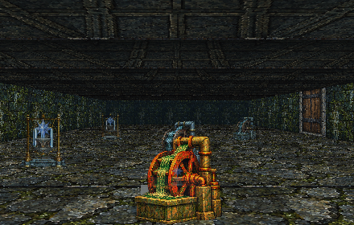
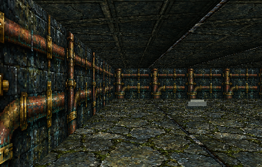

<div align="center">


# World of Maxxia · Maxxia Maker

**A browser-based, party-driven fantasy dungeon crawler and a toolkit for building portable adventure modules.**

**Engine 0.72.0** · **MP27 preview** · **Save schema 18**

[Play locally](#play-the-game) · [Build from source](#build-from-source) · [Create an adventure](#make-an-adventure-pack) · [Deploy GitHub Pages](docs/GITHUB_DEPLOYMENT.md) · [Documentation](#documentation)

</div>

> **Release scope:** This repository is a cleaned-up MP27 source snapshot. It is not the later MP28–MP39 work. Browser interaction, mobile/touch, and Windows GUI acceptance were not independently verified for this release; automated MP27 engine tests were provided with the source.

## What is it?

**World of Maxxia** is a first-person, grid-based fantasy RPG: create a party of six, explore towns and dungeons, fight monsters, manage equipment and spells, and save or transfer adventurers between campaigns. Its renderer and game logic run in the browser.

**Maxxia Maker** is the companion authoring workspace. Rather than hardcoding a new RPG for every adventure, the module system can load authored maps, NPCs, encounters, items, quests, effects and portable campaign packs. The repository also contains a **C# WinForms editor** for Windows and CLI authoring tools.

### Included in this checkpoint

- Six-character parties, dungeon exploration, turn-based combat, treasure, inventory, spellbooks and portable saves.
- Reusable content packs with manifests, dependencies, namespaces, validation and example modules.
- Generic objects, conversations, services, quests, encounters, reusable routines and effects.
- Authored scenery, sprite-state contracts, terrain hazards and mutable routes.
- **MP27:** illusory walls/openings, discoverable secrets, and reusable sequence, alignment and combination puzzles.
- A Windows editor **source project** and CLI tools for creating and validating `.maxxia` packs.

## A look inside

| Lantern Gallery | Illusions and perception |
|:--:|:--:|
|  |  |

*Images above are automated engine-render previews, not verified interactive browser screenshots.*

## Play the game

**Easiest:** download `World-of-Maxxia-MP27-Play.zip` from the GitHub release, extract it, and run one of the included launchers:

| Platform | Start command |
| --- | --- |
| Windows | Double-click `Start-World-of-Maxxia.cmd` |
| macOS / Linux | `./start-world-of-maxxia.sh` (or `node server.mjs`) |

Install **Node.js 22.18+**, then visit **http://localhost:3000/**. Do **not** open the HTML file directly with `file://`: the game loads local pack files over HTTP. The game stores local saves in your browser; keep the same browser profile and origin/port to continue them. You can also export portable saves.

**Try the MP27 puzzle demo:**

```text
http://localhost:3000/index.html?project=projects/WorldOfMaxxia/project.json&catalogue=mp27-proof/perception-lab.maxxia-build.json
```

The opening **Bells** mechanism teaches the sequence puzzle. Press **Space** to interact and **V** to search. [See the complete MP27 walkthrough](docs/MP27/AUTHORING.md).

## Build from source

Requirements: **Node.js 22.18+**, npm, and (for the Windows desktop editor) **.NET 10 SDK** on Windows.

```bash
git clone <YOUR-REPOSITORY-URL>
cd World-of-Maxxia
npm ci
npm --prefix engine/world-of-maxxia ci
npm run check:generated
npm run check:game
npm run check:mp27
npm run build:game
npm run start:game
```

Open http://localhost:3000/. `npm run build:game` creates the playable static output in `engine/world-of-maxxia/dist/`. For the alternative Vite builder, use `npm run build:game:vite`. To compile the Windows editor, use:

```powershell
dotnet build editor/MaxxiaMaker.sln -c Release
```

The packaged **browser release** is prebuilt and does not need npm. Build and CI prerequisites are described in [Building](docs/BUILDING.md). The supplied offline compiler and vendor assets are kept in the source tree for reproducible fallback builds.

## Make an adventure pack

After `npm ci`, use the pack CLI:

```bash
node tools/maxxia.mjs scaffold my-adventure --id my_adventure --title "My Adventure"
node tools/maxxia.mjs validate my-adventure --json
node tools/maxxia.mjs inspect my-adventure --json
node tools/maxxia.mjs build my-adventure --out builds/my-adventure.maxxia-build.json --json
```

Start with [MP27 authoring](docs/MP27/AUTHORING.md) for illusions and puzzles, [the pack and portability contract](docs/MP01/PACK_RULES_PORTABILITY_CONTRACT.md) for the format, and [the source architecture guide](docs/WORKSPACE.md). Real examples live in `examples/`; schemas and generated models are in `contracts/`.

## Repository map

| Path | Purpose |
| --- | --- |
| `engine/world-of-maxxia/` | Web game, renderer, runtime, assets and game tests |
| `editor/` | C# WinForms editor and shared document models |
| `toolkit/` | Reusable pack authoring/runtime libraries |
| `contracts/` | Pack schemas, fixtures and generated cross-language contracts |
| `tools/` | Build, validation and pack CLI utilities |
| `examples/` | Sample adventure content and pack fixtures |
| `docs/` | Build notes, specifications and authoring guides |
| `website/` | Public landing page used by GitHub Pages |
| `.github/workflows/` | Continuous integration and Pages publication |

## Documentation

- [Getting started and builds](docs/BUILDING.md) · [Editor quickstart](docs/EDITOR_QUICKSTART.md) · [Browser quickstart](docs/BROWSER_QUICKSTART.md)
- [Current MP27 authoring guide](docs/MP27/AUTHORING.md) · [System architecture](docs/WORKSPACE.md)
- [Contributing](CONTRIBUTING.md) · [Security reporting](SECURITY.md) · [Release notes](RELEASE_NOTES.md)
- [Publishing and GitHub Pages](docs/GITHUB_DEPLOYMENT.md)

## Status, licensing and credits

This is a **preview/checkpoint**, not a claim of completed manual cross-browser or native editor QA. Problems and reproduction steps are welcome through GitHub Issues.

**Copyright © 2026 Michael Robinson / Witches Mirror Games.** The original project code, authored content and artwork have **not** been placed under an open-source license by this packaging pass. See [`LICENSE`](LICENSE) before reusing them. Third-party components (including Phaser, EventEmitter3 and DejaVu fonts) retain their own licenses: see [`THIRD_PARTY_NOTICES.md`](engine/world-of-maxxia/THIRD_PARTY_NOTICES.md) and `engine/world-of-maxxia/licenses/`. This source release does not redistribute proprietary game assets from other games.

*World of Maxxia · Maxxia Maker — by Michael Robinson, Witches Mirror Games.*
